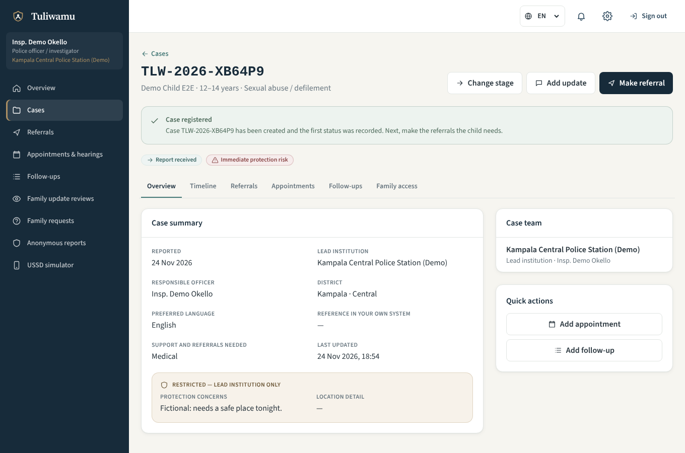
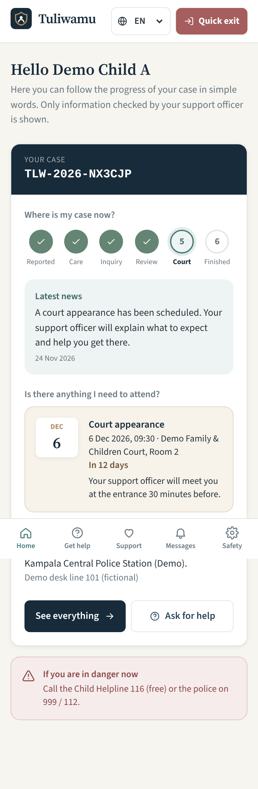
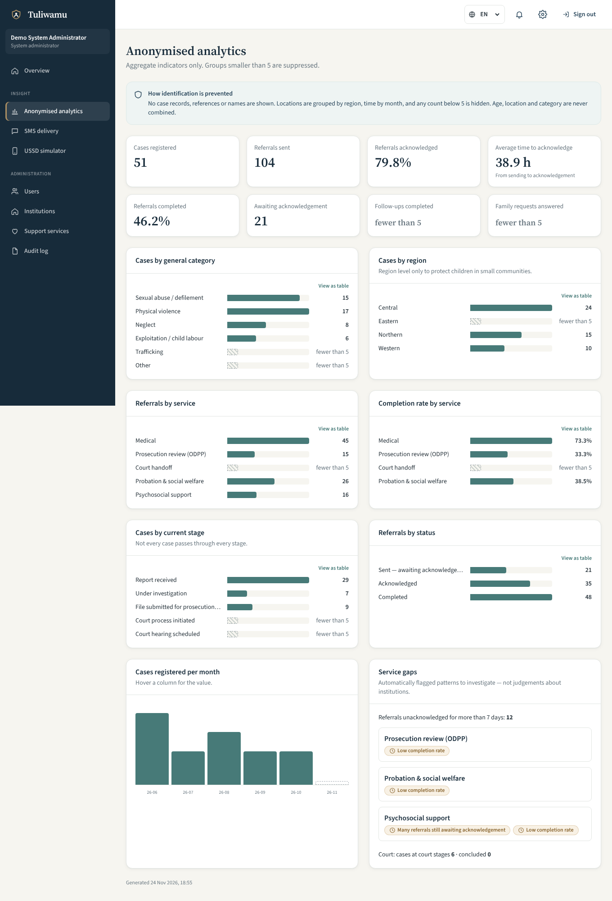
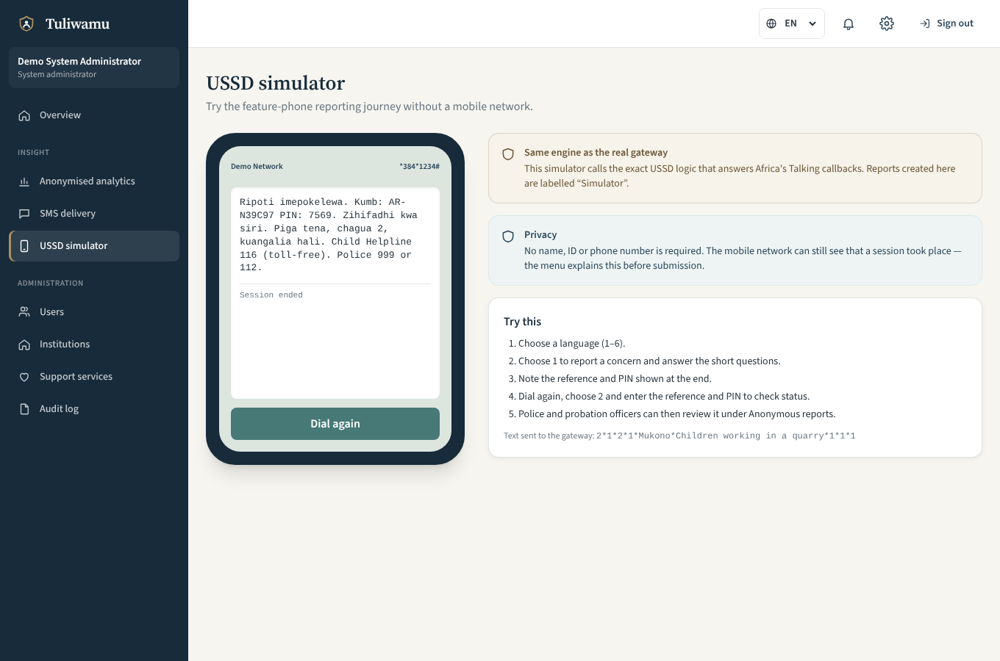

# Tuliwamu — child-sensitive justice referral & case coordination (Uganda)

> **Tuliwamu** (Luganda: *“we are here”*) is a working MVP that helps police, health workers, forensic
> services, the DPP, courts, probation & social welfare officers and support organisations coordinate
> referrals for **children who are victims of crime**. Children and authorised caregivers can follow
> **reviewed, plain-language** progress, see upcoming hearings and ask for help. Reports can also be made
> anonymously from any phone over **USSD**.

**Live demo:** https://tuliwamu.onrender.com — sign in with any demo account below (password `Tuliwamu#Demo2026`). The free hosting plan sleeps when idle, so the first visit can take about a minute to wake up.

**This is a hackathon prototype.** It uses only fictional data. It is **not** an official police, DPP,
court or health system. It is not legally certified or government-approved, and it does not replace
professional or judicial decisions.



| Child portal (phone) | Anonymised analytics | USSD simulator |
|---|---|---|
|  |  |  |

---

## What works

| Area | Status |
|---|---|
| JWT login, httpOnly rotating refresh cookie, logout, lockout, inactivity sign-out, Quick exit | ✅ Working |
| Role-based **and** object-level access (10 roles), institution isolation, 404 on out-of-scope IDs | ✅ Working, tested |
| Case registration: minimal data, random reference, duplicate check, encrypted sensitive fields | ✅ Working |
| 15 configurable case stages, each settable only by specific roles; status history | ✅ Working |
| Referral engine: purpose-specific data snapshot, send/acknowledge/start/complete/return/decline/cancel/resend, history, restricted notes for the receiver only | ✅ Working |
| Timeline with visibility (internal / case team) and **four-eyes approval** of family-facing messages | ✅ Working |
| Appointments & court hearings (court role only), rescheduling, discreet reminders | ✅ Working (`send_reminders` command) |
| Follow-ups, family assistance requests → officer → tracked follow-up → reply | ✅ Working |
| Per-case family access grants: conflict-of-interest confirmation, second-officer approval, revocation; child self-access only from age 12 | ✅ Working |
| Beneficiary portal answering the five questions: received? where? what happened? what to attend? where is help? | ✅ Working |
| Anonymised analytics: region/month level, k=5 small-cell suppression, service-gap flags | ✅ Working |
| Audit log + security events (admin cannot read case content) | ✅ Working |
| Six-language UI with a central catalogue and English fallback | ✅ English complete · Kiswahili & Luganda **drafts** · Runyankole, Acholi, Ateso **partial** — all non-English text needs review by qualified speakers |
| USSD anonymous reporting & status check (Africa's Talking callback format) + web simulator using the same engine | ✅ Working; live short code needs an Africa's Talking account |
| SMS via Africa's Talking SDK with delivery callbacks, consent, quiet hours, deduplication | ✅ Implemented. **Without credentials, a mock provider records messages as “Simulated”. Nothing is reported as delivered unless a delivery report says so.** |
| PWA app shell (API responses never cached) | ✅ Basic |

## Quick start (local)

Prerequisites: Python 3.12+, Node 20+, PostgreSQL 14+.

```bash
createuser -P tuliwamu        # password: tuliwamu_dev (or set your own in backend/.env)
```

```bash
createdb -O tuliwamu tuliwamu
```

```bash
cd backend && python -m venv .venv && source .venv/bin/activate && pip install -r requirements.txt
```

```bash
cp .env.example .env          # then set DJANGO_DEBUG=True for local work
```

```bash
python manage.py migrate && python manage.py seed_demo --reset
```

```bash
python manage.py runserver 127.0.0.1:8000
```

In a second terminal:

```bash
cd frontend && npm install && npm run dev
```

Open http://localhost:5173. Vite proxies `/api` to Django, so the refresh cookie is same-origin.

### Demo accounts (all fictional, password `Tuliwamu#Demo2026`)

The login page also has a one-click account picker.

| Username | Role | Institution |
|---|---|---|
| `police.officer` | Police investigator (lead officer for Demo Child A & B) | Kampala Central Police Station (Demo) |
| `police.supervisor` | Police supervisor (second officer for approvals, analytics) | Kampala Central Police Station (Demo) |
| `gulu.officer` | Police — **different station** (use it to show isolation) | Gulu Demo Police Station |
| `medical.officer` | Medical officer | Nakawa Demo Referral Hospital |
| `forensic.officer` | Forensic analyst | Demo Forensic Services Unit |
| `prosecutor` | ODPP state attorney (supervisor) | ODPP Demonstration Office |
| `court.registry` | Court registry clerk | Demo Family & Children Court Registry |
| `probation.officer` | Probation & social welfare (supervisor) | Kampala Demo Probation Office |
| `legalaid.officer`, `support.counsellor` | Legal aid / psychosocial support | Demo Legal Aid Clinic / Psychosocial Centre |
| `caregiver.demo` | Caregiver with an **approved** grant for Demo Child A (SMS preference on, Luganda) | — |
| `child.demo` | Demo Child A (15–17), **self-access** grant | — |
| `caregiver.other` | Caregiver with **no** grants (use to show caregivers see nothing by default) | — |
| `admin` | System administrator (no case access) | — |

The seed also creates 48 background cases with referrals, so analytics show realistic patterns. The judge
walkthrough is in [`docs/07-demo-script-and-pitch.md`](docs/07-demo-script-and-pitch.md).

## Tests

```bash
cd backend && python manage.py test            # 85 tests on PostgreSQL: auth, isolation, workflows, USSD, SMS, analytics
```

```bash
cd frontend && npm test                        # Vitest: i18n fallback, accessible status, suppression, login routing
```

```bash
node e2e/judge-flow.mjs                        # Playwright: the full judge journey in a real browser (servers must be running, fresh seed)
```

## Repository layout

```
backend/                Django + DRF
  config/               settings (env-driven), URLs
  core/                 encrypted field, references, permissions, pagination, errors, seed_demo
  accounts/             User (role), auth endpoints, admin user management
  institutions/         Institution, InstitutionMembership
  cases/                Child, ChildCase, CaseStage, CaseAssignment, CaseStatusHistory, CaseUpdate,
                        FollowUp, BeneficiaryAccessGrant, access rules (access.py), beneficiary API
  referrals/            Referral, ReferralStatusHistory, state machine (services.py)
  appointments/         Appointment, reminders
  support_services/     SupportService, AssistanceRequest
  notifications/        Notification, NotificationPreference, notify()
  communications/       ussd/ (engine shared by gateway + simulator), sms/ (providers, callbacks), AnonymousReport
  analytics/            suppression-aware aggregate indicators
  audit/                AuditLog
  translations/         backend message catalogue (SMS, USSD, notifications)
frontend/               React + Vite + Tailwind
  src/i18n/locales/     en, sw, lg, nyn, ach, teo JSON dictionaries
  src/pages/app|me|admin|public
e2e/                    Playwright judge-flow script
docs/                   architecture, API, deployment, security, research, submission, demo script
```

## Documentation

1. [Phase 1 — requirements, journey, roles, architecture, schema, risks, roadmap](docs/01-phase1-architecture.md)
2. [Security, privacy & safeguarding](docs/02-security-privacy.md)
3. [API reference](docs/03-api.md)
4. [Deployment & Africa's Talking configuration](docs/04-deployment.md)
5. [Research & evidence (sources, with what is and isn't verified)](docs/05-research-and-evidence.md)
6. [Two-page hackathon submission](docs/06-submission.md)
7. [Demo script & pitch](docs/07-demo-script-and-pitch.md)

## Known limitations

* Translations other than English are drafts. Legal, medical and safeguarding wording must be reviewed by qualified speakers.
* Legal alignment with the Children Act (as amended, including the Children (Amendment) Act, 2016) and the Data Protection and Privacy Act, 2019 has been considered in the design but **not** reviewed by a lawyer.
* Reminders and the SMS retry queue run as management commands (`send_reminders`, `process_sms_queue`, `purge_ussd_sessions`); schedule them with cron or Render Cron Jobs. No Celery is used.
* There are no document or evidence uploads, by design.
* Offline mode caches the app shell only; work done while offline is not queued.
