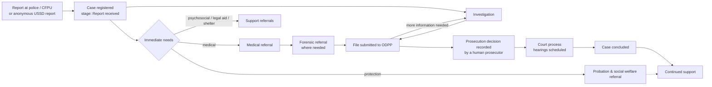
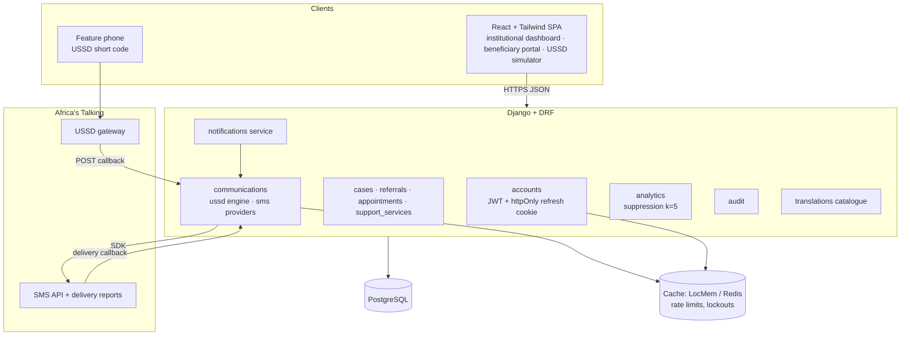
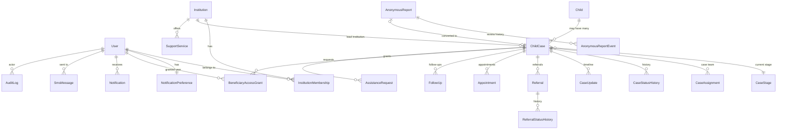
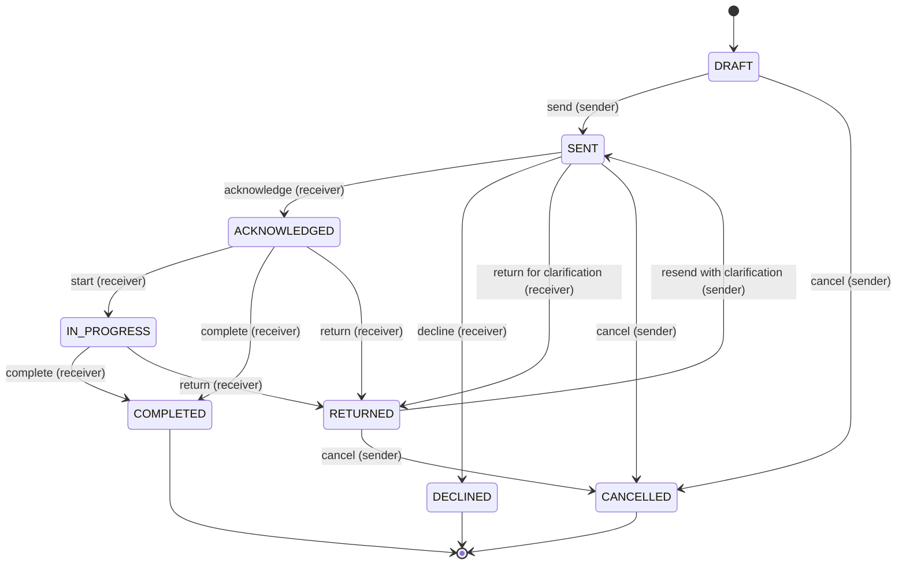

# Tuliwamu — Phase 1: Discovery & Architecture

> **Tuliwamu** (Luganda: "we are here / we are present") is a child-sensitive justice referral and case
> coordination platform prototype for Uganda. This document records the Phase 1 analysis that the
> implementation is built on. It is a **hackathon prototype**. It is not legally certified, not
> government-approved and not connected to any official police, ODPP, court or health system.

---

## 1. Requirements analysis

### 1.1 What the platform is
A **coordination layer** that sits *beside* existing institutional systems. It records:

* that a case exists, who is responsible for it and which stage it has reached;
* which referrals were made between institutions, what was shared, and whether each was acknowledged and completed;
* appointments, hearings and follow-ups;
* **reviewed**, plain-language updates for the child and authorised caregivers.

### 1.2 What the platform is not
* Not a replacement for police case files, ODPP case management, court records (e.g. ECCMIS) or clinical records.
* Not a decision maker: there is no automated prosecution decision, guilt assessment, risk scoring, prediction or facial recognition.
* Not an evidence store: forensic evidence and clinical reports stay in the institution that owns them. The platform only records **milestones** and a short **shareable outcome summary**.

### 1.3 Functional requirements (traceable to the brief)

| # | Requirement | Module | MVP priority |
|---|---|---|---|
| F1 | JWT login, refresh, logout, role-aware routing | accounts | Critical |
| F2 | Case registration with minimal data, generated reference, duplicate check | cases | Critical |
| F3 | Configurable case stages, separate from referral status | cases | Critical |
| F4 | Referrals with purpose-specific data sharing, acknowledge / progress / complete / return / decline / cancel | referrals | Critical |
| F5 | Status history and audit trail on cases and referrals | cases, referrals, audit | Critical |
| F6 | Timeline with visibility classes (internal / case team / beneficiary) | cases | Critical |
| F7 | Beneficiary-facing updates only after an officer has reviewed and approved them | cases | Critical |
| F8 | Appointments and court hearings, discreet reminders, rescheduling notices | appointments, notifications | High |
| F9 | Beneficiary portal: my cases, simple timeline, appointments, support, request assistance | beneficiary | High |
| F10 | Explicit, per-case, two-person-approved access grants for children and caregivers | cases (BeneficiaryAccessGrant) | High |
| F11 | Follow-up tasks and assistance-request handling | cases, support_services | High |
| F12 | Anonymised analytics with small-cell suppression | analytics | High |
| F13 | Six-language interface (EN, SW, LG, NYN, ACH, TEO) with a centralised catalogue | frontend i18n, translations | High |
| F14 | SMS (Africa's Talking or clearly labelled mock), delivery callbacks, no sensitive content | communications.sms | Next stage → implemented |
| F15 | USSD anonymous reporting + status check, plus a web simulator that uses the same engine | communications.ussd | Next stage → implemented |
| F16 | Admin: users, institutions, support services, audit/security events, without case content | accounts, institutions, audit | High |

### 1.4 Non-functional requirements
* **Security:** least privilege, object-level checks on every endpoint, institution isolation, rate limiting, field encryption for the most sensitive free text, audit logging, httpOnly refresh cookie.
* **Privacy:** data minimisation, no real data, no sensitive content in SMS / logs / analytics, retention controls for USSD sessions.
* **Low bandwidth:** small JS bundle, no heavy chart libraries, lazy-loaded routes, paginated APIs, no images on critical paths.
* **Accessibility:** labelled forms, ≥44px touch targets, WCAG AA contrast, status never conveyed by colour alone, plain language.
* **Safeguarding UX:** "Quick exit" button, inactivity logout, no case data in browser storage, discreet notification wording.

---

## 2. Assumptions and open questions

| Assumption | Why it matters | How to validate |
|---|---|---|
| Police (often the Child and Family Protection Unit) usually register the case first | Sets the lead institution | Interviews with CFPU officers |
| Institutions accept a coordination tool next to their own systems | Adoption | Stakeholder workshops with JLOS / Administration of Justice programme actors |
| Medical examination is documented on official forms (e.g. Police Form 3 for sexual offences) outside the platform | The platform records only the milestone | Confirm with health workers and police surgeons |
| Probation & social welfare officers can act as proxies for children without safe phone access | Beneficiary access model | MGLSD / district probation offices |
| Caregiver access must be granted case-by-case, never inferred from family relationship | Abuse is frequently intra-familial | Child-protection practitioners |
| Africa's Talking supports the required short code and sender ID in Uganda | SMS/USSD availability | Africa's Talking account and telco approvals |
| Machine-drafted translations are placeholders only | Legal/medical language must be accurate | Review by qualified speakers of each language |

**Statistics:** none are hard-coded in the product. Evidence for the submission is in `docs/05-research-and-evidence.md`, which separates verified sources from items still to be checked.

---

## 3. The child victim's journey (as modelled)

Not every case passes through every step. Stages are configured in the database (`CaseStage`), and each
stage lists which roles may set it.

---

## 4. Roles and permission matrix

Legend: ✅ allowed · 🔸 limited / scoped · ❌ denied

| Capability | Police | Medical | Forensic | ODPP | Court | Probation | Legal aid / support | Caregiver | Child | Admin |
|---|---|---|---|---|---|---|---|---|---|---|
| Register case | ✅ | ❌ | ❌ | ❌ | ❌ | ✅ | ❌ | ❌ | ❌ | ❌ |
| View full case (lead institution) | ✅ own institution | ❌ | ❌ | ❌ | ❌ | ✅ own institution | ❌ | ❌ | ❌ | ❌ |
| View case as case-team member (after acknowledging a referral) | 🔸 | 🔸 | 🔸 | 🔸 | 🔸 | 🔸 | 🔸 | ❌ | ❌ | ❌ |
| View sensitive case fields (protection concerns, exact location) | lead only | via referral snapshot only | ← | ← | ← | lead only | ← | ❌ | ❌ | ❌ |
| Create referral | ✅ | ✅ (onward) | ❌ | ✅ | ❌ | ✅ | ✅ | ❌ | ❌ | ❌ |
| Acknowledge / complete referral addressed to own institution | ✅ | ✅ | ✅ | ✅ | ✅ | ✅ | ✅ | ❌ | ❌ | ❌ |
| Read a referral's restricted notes | receiving institution only | ← | ← | ← | ← | ← | ← | ❌ | ❌ | ❌ |
| Set case stage | stages listed for role | ← | ← | ← | ← | ← | ← | ❌ | ❌ | ❌ |
| Schedule court hearing | ❌ | ❌ | ❌ | ❌ | ✅ | ❌ | ❌ | ❌ | ❌ | ❌ |
| Propose beneficiary update | ✅ | ✅ | ✅ | ✅ | ✅ | ✅ | ✅ | ❌ | ❌ | ❌ |
| Approve beneficiary update | lead institution / probation team member, not the author | | | | | ✅ | | ❌ | ❌ | ❌ |
| Grant beneficiary access | create: lead / probation; approve: a *different* officer | | | | | ✅ | | ❌ | ❌ | ❌ |
| View approved updates & appointments | ❌ | ❌ | ❌ | ❌ | ❌ | ❌ | ❌ | 🔸 granted cases | 🔸 granted cases | ❌ |
| Request assistance | ❌ | ❌ | ❌ | ❌ | ❌ | ❌ | ❌ | ✅ | ✅ | ❌ |
| Triage anonymous reports | ✅ | ❌ | ❌ | ❌ | ❌ | ✅ | ❌ | ❌ | ❌ | ❌ |
| Analytics (aggregate) | supervisors | supervisors | supervisors | supervisors | supervisors | supervisors | supervisors | ❌ | ❌ | ✅ |
| Users / institutions / audit log | ❌ | ❌ | ❌ | ❌ | ❌ | ❌ | ❌ | ❌ | ❌ | ✅ (no case content) |

Notes:
* Being an administrator **does not** grant access to case content.
* A caregiver granted access to one case gets **no** access to any other case involving the same child.
* Grants require: relationship, a written basis, explicit confirmation of a conflict-of-interest check (for example, the caregiver is not implicated in the allegation), and approval by a second officer. Direct access for a child is only allowed for age bands 12–14 and 15–17.

---

## 5. Architecture

* **Authorization lives in the backend.** The frontend hides pages per role for usability only; every viewset filters its queryset by the caller's institution, case participation or grant, so changing a UUID in the URL returns `404`.
* **Purpose-specific sharing.** A referral stores a snapshot of only the fields the sender selected (`shared_fields` → `shared_data`).
* **Provider abstraction.** `SmsProvider` has `MockSmsProvider` (status `SIMULATED`, never shown as delivered) and `AfricasTalkingSmsProvider` (status `SUBMITTED` until the delivery callback reports `Success`).
* **One USSD engine.** `UssdEngine.handle(...)` serves the Africa's Talking callback and the web simulator.

---

## 6. Database schema (summary)

All sensitive records use UUID primary keys. Human-facing references (`TLW-2026-7K3QX9`, `REF-…`, `AR-…`) are random, not sequential.

| Model | Key fields | Notes |
|---|---|---|
| `User` | uuid, username, full_name, email, phone, role, preferred_language | Roles are an enum on the user; no Role table needed |
| `Institution` | uuid, name, type, district, region | Types: police, health, forensic, odpp, court, probation, legal_aid, psychosocial, shelter |
| `InstitutionMembership` | user, institution, title, is_supervisor, is_active | Unique (user, institution) |
| `Child` | uuid, pseudonym, age_range, sex (optional) | No legal names. Many cases per child |
| `CaseStage` | code, label, order, allowed_roles, beneficiary_label, journey_step | Configurable lifecycle |
| `ChildCase` | uuid, reference, child, lead_institution, assigned_officer, incident_category, district, region, location_detail*, protection_concerns*, immediate_risk, stage | *encrypted at rest |
| `CaseAssignment` | case, institution, officer, role_in_case, is_active | Defines the case team |
| `CaseStatusHistory` | case, from_stage, to_stage, changed_by, institution, note | Append-only |
| `CaseUpdate` | case, institution, author, category, note, visibility, beneficiary_message, beneficiary_status, approved_by | Beneficiary text needs approval |
| `Referral` | uuid, reference, case, sending/receiving institution, category, priority, shared_fields, shared_data, purpose, status, timestamps, outcome_summary, restricted_notes* | Status machine below |
| `ReferralStatusHistory` | referral, from_status, to_status, actor, note | Append-only |
| `Appointment` | case, institution, type, scheduled_for, public_location, status, visible_to_beneficiary, reminder_sent_at | Court hearings: court role only |
| `FollowUp` | case, referral?, assistance_request?, assigned_to, due_date, status | Follow-up management |
| `SupportService` | institution, category, name, public_contact, languages, districts | Directory |
| `AssistanceRequest` | case, requested_by, type, message, status, assigned_to, response | From beneficiary portal |
| `BeneficiaryAccessGrant` | case, user, relationship, basis, conflict_check_confirmed, status, created_by, approved_by, valid_until | Two-person rule |
| `Notification` | recipient, type, title, body, link, is_read, dedup_key | Body never contains case details |
| `NotificationPreference` | user, preferred_channel, sms_allowed, safe_phone*, quiet hours, consent_reference | Consent before SMS |
| `SmsMessage` | recipient, masked phone, template, language, type, status, provider, provider_message_id, dedup_key | Delivery tracking |
| `AnonymousReport` | uuid, reference_code, pin_hash, category, immediate_danger, general_location, description*, safe_contact*, verification_status, review_status, converted_case | Separate from cases |
| `UssdSession` | session_id, language, current_menu, data, last_text, last_response, expires_at | Purged after expiry |
| `AuditLog` | actor, role, institution, action, object_type, object_id, success, metadata | No sensitive values |

### Referral state machine

---

## 7. API contract (summary)

Full reference: `docs/03-api.md`.

| Area | Endpoints |
|---|---|
| Auth | `POST /api/auth/login/`, `POST /api/auth/refresh/`, `POST /api/auth/logout/`, `GET /api/auth/me/`, `POST /api/auth/password-reset/`, `POST /api/auth/password-reset/confirm/` |
| Cases | `GET/POST /api/cases/`, `GET/PATCH /api/cases/{id}/`, `POST /api/cases/{id}/change-stage/`, `GET /api/cases/{id}/timeline/`, `GET /api/cases/{id}/history/`, `POST /api/cases/{id}/updates/`, `POST /api/case-updates/{id}/approve/` |
| Referrals | `GET/POST /api/referrals/`, `GET /api/referrals/{id}/`, `POST /api/referrals/{id}/{send,acknowledge,start,complete,return,decline,cancel,resend}/` |
| Appointments | `GET/POST /api/appointments/`, `PATCH /api/appointments/{id}/` |
| Follow-ups | `GET/POST /api/follow-ups/`, `PATCH /api/follow-ups/{id}/` |
| Access grants | `GET/POST /api/access-grants/`, `POST /api/access-grants/{id}/{approve,revoke}/` |
| Beneficiary | `GET /api/beneficiary/cases/`, `GET /api/beneficiary/cases/{id}/`, `GET /api/beneficiary/cases/{id}/updates/`, `GET/POST /api/beneficiary/assistance-requests/` |
| Notifications | `GET /api/notifications/`, `PATCH /api/notifications/{id}/read/`, `GET/PATCH /api/notifications/preferences/` |
| Analytics | `GET /api/analytics/overview/`, `/referrals/`, `/case-progress/` |
| Communications | `POST /api/communications/ussd/callback/` (Africa's Talking), `POST /api/communications/ussd/simulator/`, `POST /api/communications/sms/delivery-callback/`, `GET /api/communications/sms/dashboard/`, `GET/… /api/anonymous-reports/` |
| Admin | `/api/admin/users/`, `/api/institutions/`, `/api/support-services/`, `/api/audit-logs/` |

---

## 8. Risks and mitigations

| Risk | Impact | Mitigation in the MVP |
|---|---|---|
| Alleged abuser obtains caregiver access | Severe harm to the child | Per-case grants only, conflict check confirmation, second-officer approval, revocation, audit |
| Sensitive text leaks in SMS on a shared phone | Exposure, retaliation | Fixed discreet templates without case data, consent + safe number + quiet hours |
| Officer browses cases outside their mandate | Privacy breach | Institution-scoped querysets, case-team model, view auditing, 404 on out-of-scope IDs |
| Over-sharing in referrals | Privacy breach | Sender picks fields; receiver sees only the snapshot until it acknowledges; clinical notes stay with the receiver |
| Re-identification through analytics | Child identified in a small community | Region-level grouping, months not dates, k=5 suppression, no cross-tabs of age × location × offence |
| Malicious or spam USSD reports | Wasted effort, false allegations | Marked unverified, rate limits on a salted phone hash in the cache only, human triage, never auto-converted |
| Poor translations of legal language | Misunderstanding | Translations labelled drafts; English fallback; human review workflow documented |
| Network outages | Lost work | Small payloads, retry on idempotent GETs, drafts kept in memory only, clear offline banner |
| Prototype taken as an official system | Legal & reputational | Disclaimer on login and in documentation |
| Provider outage (Africa's Talking) | Missed reminders | Failures recorded, retry command, in-app notification always created |

---

## 9. Development roadmap

| Phase | Output | Exit criterion |
|---|---|---|
| 1 Discovery | This document | Reviewed |
| 2 Setup | Django project, React/Vite/Tailwind, PostgreSQL, env files | `manage.py check` passes, `vite build` passes |
| 3 Backend | Models, services, permissions, APIs, seed command, tests | `manage.py test` green on PostgreSQL |
| 4 Frontend | Design system, auth, dashboards, workflows, i18n | `vite build` passes, unit tests green |
| 5 Integration | All forms hit real APIs | Scripted end-to-end judge flow passes in a real browser |
| 6 Security QA | Permission/isolation tests, leakage tests | All isolation tests green |
| 7 Delivery | README, API docs, deployment guide, submission, demo script | Docs complete |
